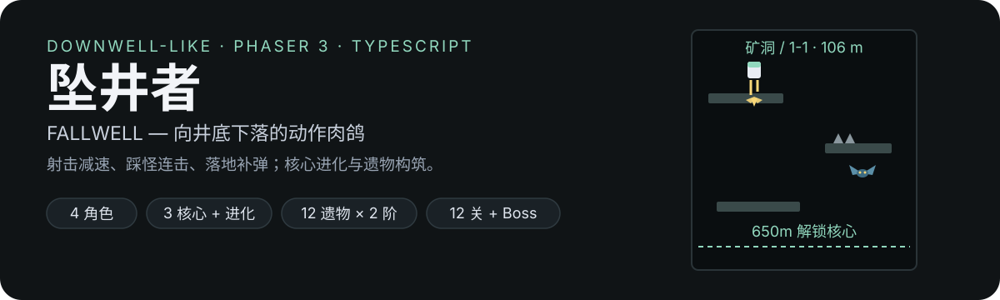
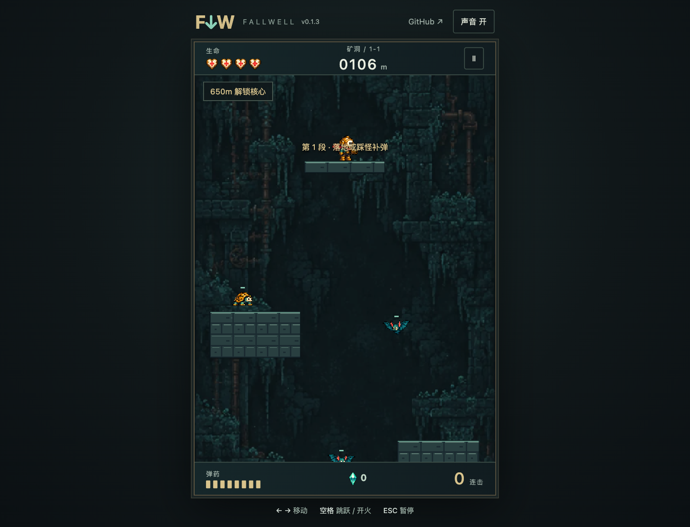
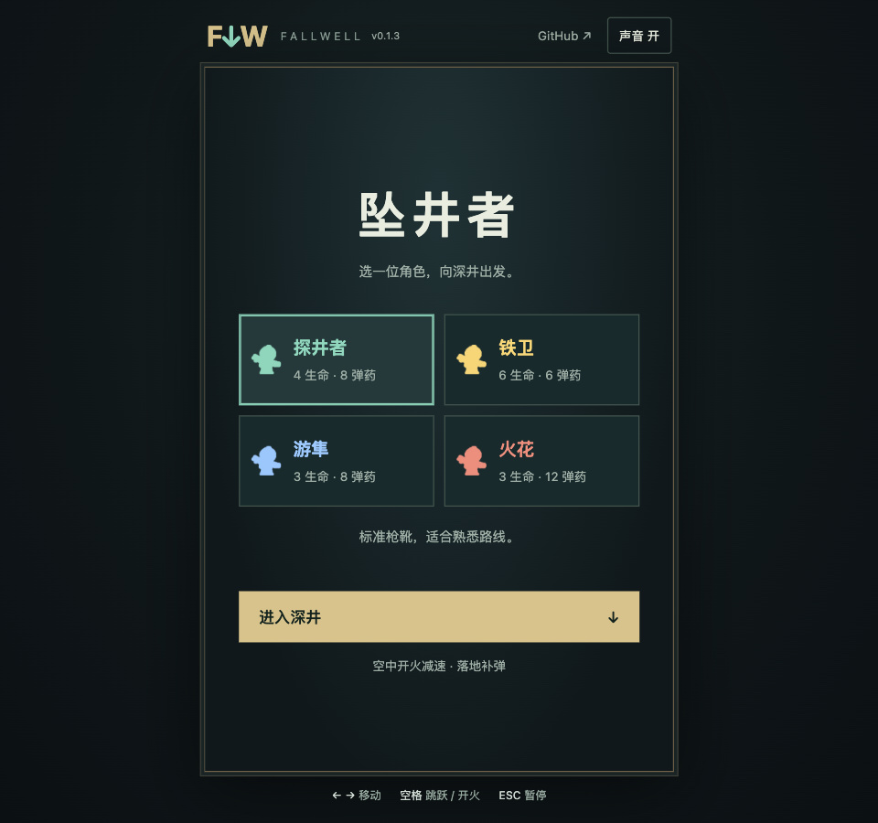

<p align="right"><a href="README.md">中文</a></p>

<p align="center">
  
</p>

<p align="center">
  <a href="https://fallwell.xiaosang.cc/">▶ Play Online</a>
  ·
  <a href="https://github.com/holynova/fallwell">GitHub Repository</a>
</p>

Fallwell is a Downwell-inspired browser descent roguelite: fall ever deeper down the well, slow your descent by firing mid-air, chain stomps for combos, and reload by landing. Pick a character, build around an evolving core and relics, and fight the warden at the bottom.

## Screenshots

<p align="center">
  
  
</p>

## How to Play

- **Descend**: keep going down; depth is measured in meters. Your personal best depth and highest combo are stored locally.
- **Brake with gunfire**: hold Space mid-air to fire downward — the recoil slows your fall. Ammo only refills on landing (or on stomps); it never regenerates in the air.
- **Stomp combos**: land on an enemy's head to stomp it and bounce back up; chain stomps to build combos. Spiked enemies can't be stomped.
- **Heavy landing**: landing at high speed releases a shockwave that breaks rock and hurts enemies.
- **Core at 650 m**: reach 650 m to gain your first core; collect two same-family relics to evolve it.
- **Shops & rest rooms**: spend crystals on relics at shops along the way, and rest between sections; trial sections offer extra rewards.

| Action | Key |
|---|---|
| Move left / right | ← → or A / D |
| Jump / fire mid-air | Space (jump on the ground, fire in the air) |
| Pause | ESC |

## Characters

| Character | Role | HP | Ammo | Notes |
|---|---|---|---|---|
| 探井者 (Scout) | Balanced | 4 | 8 | Standard gunboots, good for learning the routes |
| 铁卫 (Warden) | Survival | 6 | 6 | More HP, slower movement, smaller magazine |
| 游隼 (Ranger) | Agile | 3 | 8 | Faster movement and fire rate, less HP |
| 火花 (Gunner) | Firepower | 3 | 12 | Large magazine, less HP, slightly slower |

## Cores & Relics

- **3 cores, each with an evolution**: 弹幕 (Barrage, shooting) → 风暴五连发 (Storm, five-shot volley); 跃击 (Leap, stomping) → 雷链 (Chain Lightning, wide-area shock); 陨落 (Fall, heavy landing) → 地裂 (Fissure, cracks spreading along platforms). Cores are mutually exclusive; evolving one needs two same-family relics.
- **12 relics, 2 ranks each**: shooting — 穿井针 (Well-Piercing Needle) / 聚能匣 (Energy Cell) / 余震弹 (Aftershock Round); stomping — 连锁雷 (Chain Lightning) / 弹簧跟 (Spring Heel) / 猎手眼 (Hunter's Eye); heavy landing — 冲击环 (Shock Ring) / 接地甲 (Grounding Armor) / 破岩靴 (Rockbreaker Boots); universal — 扩容匣 (Extended Mag) / 旧日护符 (Olden Amulet) / 采晶器 (Crystal Harvester).

## Levels

- **12 stages + boss**: 4 zones — 矿洞 (Mine), 墓穴 (Crypt), 蓄水层 (Aquifer), 虚空 (Void), 3 stages each; clear them to challenge the 井底守卫 (Warden of the Well Bottom), whose weak point can be shot, stomped, or shocked — closed armor is immune to damage.
- **Procedural generation**: 6 chunk types (平台穿越 Platform Traverse, 踩踏连锁 Stomp Chain, 碎石门 Rubble Gate, 交叉火力 Crossfire, 红叉路 Red Crossroads, 断裂阶梯 Broken Steps) are stitched together by seed, mirrorable; the same seed generates the same enemies and rewards.

## Run Locally

```bash
npm ci
npm run dev      # dev server
npm run build    # type check + production build
npm test         # simulation tests (33 cases)
```

## Tech

- Phaser 3.90 + TypeScript + Vite; the simulation layer (`src/simulation.ts`) runs at a fixed 120 Hz, decoupled from rendering, so tests run directly in Node.
- Procedural music and sound effects (Web Audio, lookahead scheduling, separate music / SFX buses).
- Pixel art: `public/assets/art/` (zone and character atlases, PNG + WebP).

```
index.html              Entry (#app + main.ts)
src/main.ts             Phaser scenes + DOM UI (character select / pause / results)
src/simulation.ts       Simulation: movement / shooting / stomping / relics / boss
src/data.ts             Data tables: 4 characters / 3 cores / 12 relics
src/levels.ts           Level generation: 12 stages, 4 zones, 6 chunk types
src/art.ts              Pixel art rendering
src/audio.ts            Procedural music and sound effects
src/simulation.test.ts  33 simulation tests
public/assets/art/      Pixel art (zones / characters)
```
