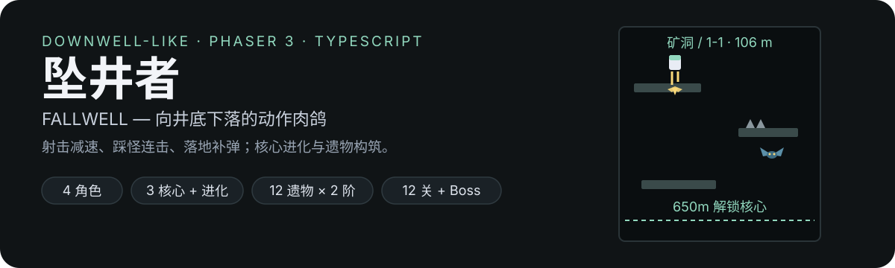
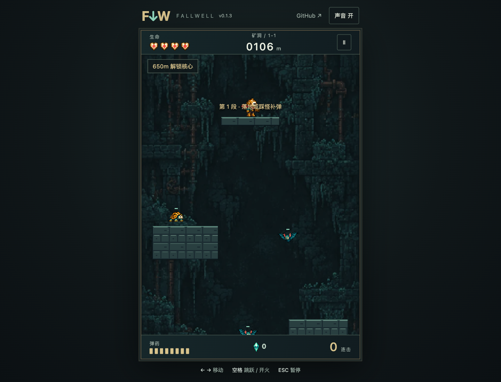
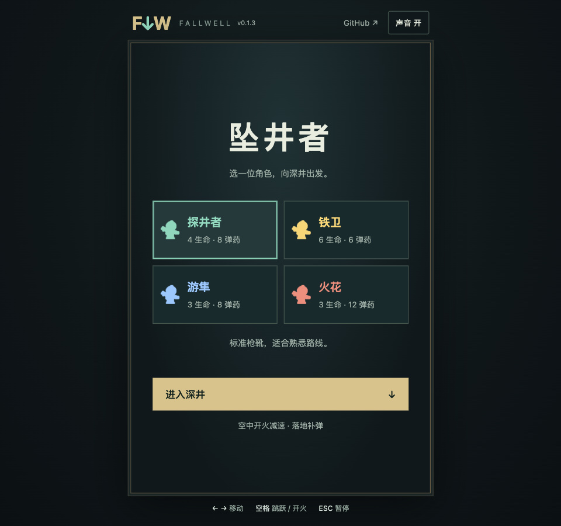

<p align="center">
  
</p>

<p align="center">
  <a href="https://fallwell.xiaosang.cc/">▶ 在线玩 Play Online</a>
  ·
  <a href="https://github.com/holynova/fallwell">GitHub 仓库</a>
</p>

坠井者是一款受 Downwell 启发的浏览器下落动作肉鸽：向井底不断下落，空中射击减速、踩怪连击、落地补弹；选角色、搭核心、集遗物，一路打到井底守卫。

Fallwell is a Downwell-inspired browser descent roguelite: fall ever deeper down the well, slow your descent by firing mid-air, chain stomps for combos, and reload by landing. Pick a character, build around an evolving core and relics, and fight the warden at the bottom.

## 截图 / Screenshots

<p align="center">
  
  
</p>

## 玩法 / How to Play

- **下落**：一直往下走，深度以米计；个人最深纪录与最高连击存在本地。
- **射击减速**：空中按住空格向下开火，子弹反冲减缓下落；弹药只在落地（或踩怪）时补满，空中永远不会自动回复。
- **踩怪连击**：落在敌人头上踩死它并弹起，连续踩踏攒连击；尖刺怪和带刺敌人不能踩。
- **重坠**：高速落地释放冲击波，可破岩、可伤敌。
- **650 米解锁核心**：下到 650 米获得首个核心；集齐同系两件遗物后核心进化。
- **商店与休整**：途中有商店（花晶石买遗物）与休整间；试炼路段有额外奖励。

| 操作 | 按键 |
|---|---|
| 左右移动 | ← → 或 A / D |
| 跳跃 / 空中射击 | 空格（地面跳跃，空中开火） |
| 暂停 | ESC |

## 角色 / Characters

| 角色 | 定位 | 生命 | 弹药 | 特点 |
|---|---|---|---|---|
| 探井者 | 均衡 | 4 | 8 | 标准枪靴，适合熟悉路线 |
| 铁卫 | 生存 | 6 | 6 | 生命更多，移动较慢，弹匣较小 |
| 游隼 | 敏捷 | 3 | 8 | 移动更快、开火更快，生命较少 |
| 火花 | 火力 | 3 | 12 | 大弹匣，生命较少，移动略慢 |

## 核心与遗物 / Cores & Relics

- **3 个核心，各带进化**：弹幕（射击）→ 风暴五连发；跃击（踩踏）→ 雷链大范围冲击；陨落（重坠）→ 地裂沿平台扩散。核心互斥，进化需集齐同系两件遗物。
- **12 件遗物，每件 2 阶**：射击系穿井针 / 聚能匣 / 余震弹，踩踏系连锁雷 / 弹簧跟 / 猎手眼，重坠系冲击环 / 接地甲 / 破岩靴，通用系扩容匣 / 旧日护符 / 采晶器。

## 关卡 / Levels

- **12 关 + Boss 战**：4 个区域——矿洞、墓穴、蓄水层、虚空，每区 3 关；打通后挑战井底守卫（弱点可射击、可踩踏、可震击，闭合装甲免疫伤害）。
- **程序生成**：6 种区块（平台穿越、踩踏连锁、碎石门、交叉火力、红叉路、断裂阶梯）按种子随机拼接、可镜像；同一种子生成同样的敌人与奖励。

## 本地运行 / Run Locally

```bash
npm ci
npm run dev      # 开发服务器
npm run build    # 类型检查 + 生产构建
npm test         # 模拟测试（33 个用例）
```

## 技术 / Tech

- Phaser 3.90 + TypeScript + Vite；模拟层（`src/simulation.ts`）以 120Hz 定步长运行，与渲染分离，可在 Node 里直接跑测试。
- 程序化配乐与音效（Web Audio，前瞻调度，音乐 / 音效独立总线）。
- 像素美术：`public/assets/art/`（区域与角色图集，PNG + WebP）。

```
index.html              入口（#app + main.ts）
src/main.ts             Phaser 场景 + DOM 界面（选角 / 暂停 / 结算）
src/simulation.ts       模拟：移动 / 射击 / 踩踏 / 遗物 / Boss
src/data.ts             数据表：4 角色 / 3 核心 / 12 遗物
src/levels.ts           关卡生成：12 关、4 区域、6 种区块
src/art.ts              像素美术渲染
src/audio.ts            程序化配乐与音效
src/simulation.test.ts  33 个模拟测试
public/assets/art/      像素美术（区域 / 角色）
```

## English

**Fallwell** is a Downwell-inspired descent roguelite for the browser: fall down the well, brake with gunfire, stomp enemies for combos, and reload by landing.

- **Core loop**: firing mid-air slows your fall; ammo only refills on landing or stomps — never in the air. High-speed landings release a shockwave that breaks rock and hurts enemies.
- **4 characters** (Scout, Warden, Ranger, Gunner) with different HP/ammo/speed; **3 cores** (Barrage, Leap, Fall), each evolving after collecting two same-family relics; **12 relics** in two ranks each.
- **12 stages + boss** across 4 zones (Mine, Crypt, Aquifer, Void); 6 procedural chunk types, seed-stable generation; shops, rest rooms, and trial sections along the way.
- **Controls**: ← → / A D to move, Space to jump (ground) or fire (air), ESC to pause. Keyboard only.
- **Run it**: `npm ci && npm run dev`; tests: `npm test` (33 simulation cases).
- **Tech**: Phaser 3.90 + TypeScript + Vite; the simulation runs at a fixed 120 Hz, decoupled from rendering; procedural Web Audio music and SFX.
